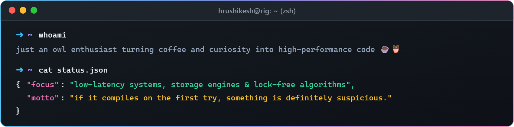

  

  
  &nbsp;&nbsp;&nbsp;
  
  &nbsp;&nbsp;&nbsp;
  
  &nbsp;&nbsp;&nbsp;
  

  

## ⚡ Algorithms & Competitive Programming

  
  &nbsp;&nbsp;
  
  &nbsp;&nbsp;
  

  
  &nbsp;&nbsp;&nbsp;&nbsp;
  

  

  

## 🛠️ Flagship Systems & Engineering

<table width="100%">
  <tr>
    <th width="32%" align="left">🚀 System / Engine</th>
    <th width="48%" align="left">📖 Architecture &amp; Highlights</th>
    <th width="20%" align="center">🏷️ Core Stack</th>
  </tr>
  <tr>
    <td align="left">
      <b><a href="https://github.com/Hrushikesh-ramilla/NullRing">NullRing</a></b> 
      Ultra-low latency execution engine
    </td>
    <td align="left">
      Achieves <b>sub-200ns processing</b> with zero runtime allocations, lock-free ring design, and explicit memory ordering for hardware-constrained systems.
    </td>
    <td align="center">
      
    </td>
  </tr>
  <tr>
    <td align="left">
      <b><a href="https://github.com/Hrushikesh-ramilla/AccretionDB">AccretionDB</a></b> 
      Log-structured KV storage engine
    </td>
    <td align="left">
      WiscKey-inspired design that decouples keys and values to minimize write amplification and optimize SSD bandwidth and crash consistency.
    </td>
    <td align="center">
      
    </td>
  </tr>
  <tr>
    <td align="left">
      <b><a href="https://github.com/Hrushikesh-ramilla/OrionScheduler">OrionScheduler</a></b> 
      Crash-consistent DAG engine
    </td>
    <td align="left">
      Deterministic workflow orchestration under concurrency with single-owner event loops and Write-Ahead Log (WAL) recovery.
    </td>
    <td align="center">
      
    </td>
  </tr>
  <tr>
    <td align="left">
      <b><a href="https://github.com/Hrushikesh-ramilla/RaftNova">RaftNova</a></b> 
      Distributed consensus algorithm
    </td>
    <td align="left">
      Raft-backed state machine replication, leader election, log compaction, and deterministic fault tolerance under network partitions.
    </td>
    <td align="center">
      
    </td>
  </tr>
</table>

  

## 🌐 Open Source Footprint (230+ PRs)

<table width="100%">
  <tr>
    <th width="32%" align="left">📂 Domain</th>
    <th width="68%" align="left">🌟 Key Contributions &amp; Repositories</th>
  </tr>
  <tr>
    <td align="left"><b>🏎️ Storage &amp; Database Engines</b></td>
    <td align="left">
      &nbsp;
      &nbsp;
      
       Analytical execution kernels, memory managers, and vectorized query operators.
    </td>
  </tr>
  <tr>
    <td align="left"><b>⚡ Compilers &amp; SIMD Acceleration</b></td>
    <td align="left">
      &nbsp;
      &nbsp;
      
       AVX-512 / ARM Neon vectorization, unicode transcoding pipelines, and kernel optimizations.
    </td>
  </tr>
  <tr>
    <td align="left"><b>☁️ Cloud-Native &amp; Infrastructure</b></td>
    <td align="left">
      &nbsp;
      &nbsp;
      
       OCI container artifact specs, controller reconciliation, and static analysis tooling.
    </td>
  </tr>
  <tr>
    <td align="left"><b>🌐 Web Ecosystem &amp; Frameworks</b></td>
    <td align="left">
      &nbsp;
      &nbsp;
      
       Async state management, high-performance HTTP pipelines, and modern browser internals.
    </td>
  </tr>
</table>

  

## 💻 Technical Arsenal

<table align="center" width="100%">
  <tr>
    <td width="10%" align="center"> <b>C</b></td>
    <td width="10%" align="center"> <b>C++</b></td>
    <td width="10%" align="center"> <b>Rust</b></td>
    <td width="10%" align="center"> <b>Go</b></td>
    <td width="10%" align="center"> <b>Python</b></td>
    <td width="10%" align="center"> <b>Java</b></td>
    <td width="10%" align="center"> <b>TypeScript</b></td>
    <td width="10%" align="center"> <b>JavaScript</b></td>
    <td width="10%" align="center"> <b>Bash</b></td>
    <td width="10%" align="center"> <b>Linux</b></td>
  </tr>
  <tr>
    <td width="10%" align="center"> <b>Docker</b></td>
    <td width="10%" align="center"> <b>Kubernetes</b></td>
    <td width="10%" align="center"> <b>Cloudflare</b></td>
    <td width="10%" align="center"> <b>Git</b></td>
    <td width="10%" align="center"> <b>GitHub Actions</b></td>
    <td width="10%" align="center"> <b>CMake</b></td>
    <td width="10%" align="center"> <b>Node.js</b></td>
    <td width="10%" align="center"> <b>React</b></td>
    <td width="10%" align="center"> <b>Next.js</b></td>
    <td width="10%" align="center"> <b>FastAPI</b></td>
  </tr>
  <tr>
    <td width="10%" align="center"> <b>Tailwind CSS</b></td>
    <td width="10%" align="center"> <b>Three.js</b></td>
    <td width="10%" align="center"> <b>Electron</b></td>
    <td width="10%" align="center"> <b>Tauri</b></td>
    <td width="10%" align="center"> <b>TensorFlow</b></td>
    <td width="10%" align="center"> <b>PyTorch</b></td>
    <td width="10%" align="center"> <b>PostgreSQL</b></td>
    <td width="10%" align="center"> <b>MongoDB</b></td>
    <td width="10%" align="center"> <b>Redis</b></td>
    <td width="10%" align="center"> <b>SQLite</b></td>
  </tr>
</table>

  

  

  
  &nbsp;&nbsp;&nbsp;&nbsp;
  

