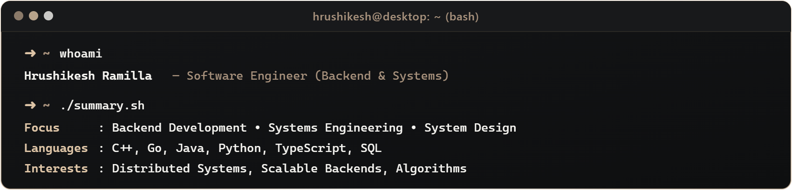

  

  
  &nbsp;&nbsp;&nbsp;
  
  &nbsp;&nbsp;&nbsp;
  
  &nbsp;&nbsp;&nbsp;
  

  

## ⚡ Algorithms & Competitive Programming

  
  &nbsp;&nbsp;
  
  &nbsp;&nbsp;
  

  
  &nbsp;&nbsp;&nbsp;&nbsp;
  

  

  

## 🌐 Open Source Contributions

<table width="100%">
  <tr>
    <th width="32%" align="left">Category</th>
    <th width="68%" align="left">Projects &amp; Contributions</th>
  </tr>
  <tr>
    <td align="left"><b>Database &amp; Storage Engines</b></td>
    <td align="left">
      &nbsp;
      
       Contributed to query execution operators, memory management, and data processing routines.
    </td>
  </tr>
  <tr>
    <td align="left"><b>Core Systems &amp; Performance Libraries</b></td>
    <td align="left">
      &nbsp;
      &nbsp;
      
       Parser vectorization optimizations, model runtime execution, and library performance improvements.
    </td>
  </tr>
  <tr>
    <td align="left"><b>Cloud-Native &amp; Infrastructure</b></td>
    <td align="left">
      
       Kubernetes controller reconciliation, automated secret rollouts, and configuration lifecycle.
    </td>
  </tr>
</table>

  

## 💻 Technical Arsenal

<table align="center" width="100%">
  <tr>
    <td width="10%" align="center"> <b>C</b></td>
    <td width="10%" align="center"> <b>C++</b></td>
    <td width="10%" align="center"> <b>Rust</b></td>
    <td width="10%" align="center"> <b>Go</b></td>
    <td width="10%" align="center"> <b>Python</b></td>
    <td width="10%" align="center"> <b>Java</b></td>
    <td width="10%" align="center"> <b>TypeScript</b></td>
    <td width="10%" align="center"> <b>JavaScript</b></td>
    <td width="10%" align="center"> <b>Bash</b></td>
    <td width="10%" align="center"> <b>Linux</b></td>
  </tr>
  <tr>
    <td width="10%" align="center"> <b>Docker</b></td>
    <td width="10%" align="center"> <b>Kubernetes</b></td>
    <td width="10%" align="center"> <b>Cloudflare</b></td>
    <td width="10%" align="center"> <b>Git</b></td>
    <td width="10%" align="center"> <b>GitHub Actions</b></td>
    <td width="10%" align="center"> <b>CMake</b></td>
    <td width="10%" align="center"> <b>Node.js</b></td>
    <td width="10%" align="center"> <b>React</b></td>
    <td width="10%" align="center"> <b>Next.js</b></td>
    <td width="10%" align="center"> <b>FastAPI</b></td>
  </tr>
  <tr>
    <td width="10%" align="center"> <b>Tailwind CSS</b></td>
    <td width="10%" align="center"> <b>Three.js</b></td>
    <td width="10%" align="center"> <b>Electron</b></td>
    <td width="10%" align="center"> <b>Tauri</b></td>
    <td width="10%" align="center"> <b>TensorFlow</b></td>
    <td width="10%" align="center"> <b>PyTorch</b></td>
    <td width="10%" align="center"> <b>PostgreSQL</b></td>
    <td width="10%" align="center"> <b>MongoDB</b></td>
    <td width="10%" align="center"> <b>Redis</b></td>
    <td width="10%" align="center"> <b>SQLite</b></td>
  </tr>
</table>

  

  

